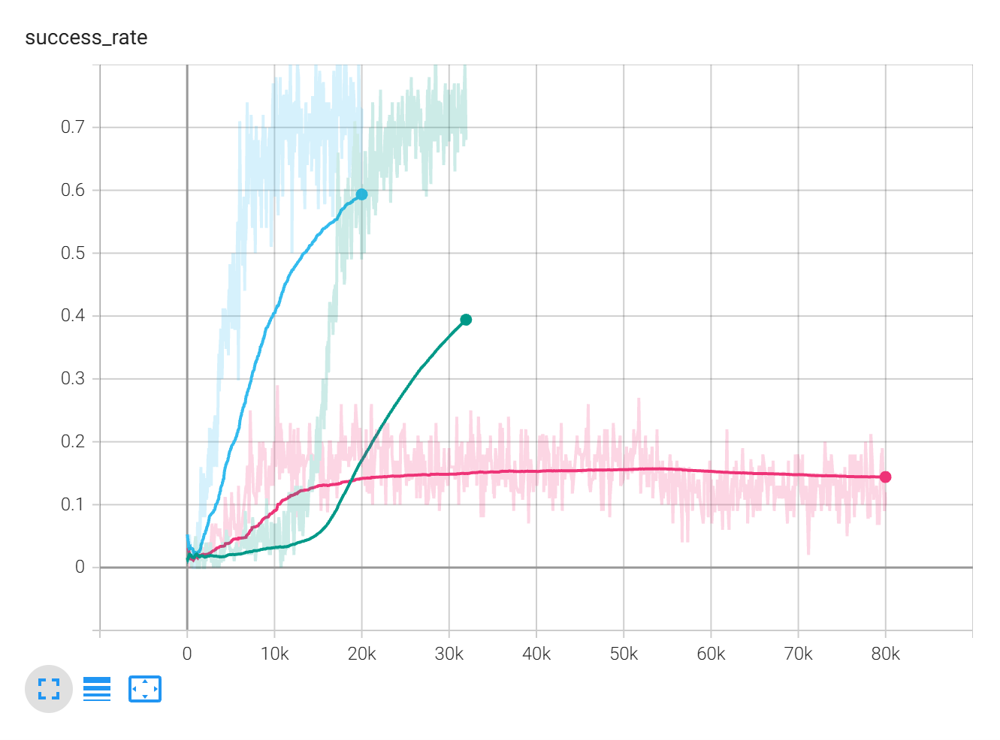
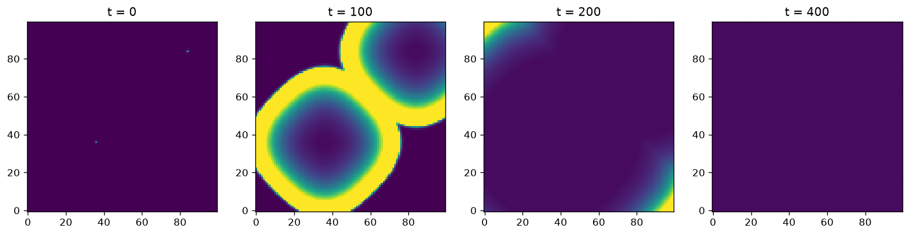
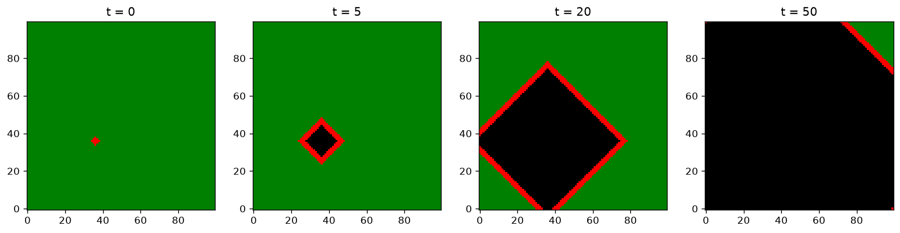

# RL Wildfire Agent

Research project training a reinforcement learning agent to make wildfire-suppression decisions inside **Cadmium v2**, a C++ DEVS / Cell-DEVS simulator (Prof. Gabriel Wainer's lab).

This repo starts with the foundations: neural networks, classic RL algorithms, and DEVS models. The wildfire agent will be added as the project progresses.

## Roadmap

| Folder | What's inside | Status |
|---|---|---|
| `01_neural_networks` | FFN and CNN on MNIST, plus a hand-written graph neural network (GCN) predicting fire spread on a toy graph | Done |
| `02_gymnasium` | First look at Gymnasium: Frozen Lake intro, Minigrid exploration | Done |
| `03_rl_algorithms` | Q-learning, REINFORCE and PPO from scratch on slippery Frozen Lake | Done, PPO tuning pending |
| `04_cadmium` | Cell-DEVS logs visualized in Python, a toy fire-spread Cell-DEVS model and a toy atomic model in C++ | Done |
| `05_rl_cadmium` | RL agent controlling fire suppression in Cadmium | Next |

## Results

### Neural networks (MNIST, 2 epochs)
- Feed-forward network: **96.5%** test accuracy
- CNN: **98.45%** test accuracy
- GCN on a toy fire-spread graph: **98.95%** (baseline ~62%)

### RL on slippery Frozen Lake

- **Q-learning** learns fastest and reaches **~0.78** success rate. A lookup table is hard to beat on a 16-state grid.
- **REINFORCE**: plain version stalled around 0.2. Batching episodes (16 per update) and normalizing returns raised it to **~0.70**. The pink curve above is an earlier batch-8 run.
- **PPO** (actor-critic, clipped loss) starts slow, then catches up (raw success ~0.7 by 30k steps). Hyperparameter tuning still to do.

### Cadmium: SIR epidemic (Cell-DEVS example)

Two infection waves spread across a 100x100 grid and cancel out where they meet, since cells behind each front have already recovered.

### Cadmium: my toy fire-spread model

Each cell is unburnt (green), burning (red) or burnt (black). A cell ignites when a neighbour is burning, burns for a set number of time steps, then burns out. Written in C++ in `04_cadmium/fire_model`.

## Tools
Python, PyTorch, Gymnasium, TensorBoard, pandas, matplotlib, C++17, Cadmium v2, WSL2 Ubuntu.

## Running
- Notebooks: open in Jupyter with PyTorch, Gymnasium, pandas and matplotlib installed.
- Cadmium models: copy `04_cadmium/fire_model` into `cadmium_v2/example/celldevs_fire`, build with `source build.sh`, then run `../../bin/main_grid_fire grid_config.json 100` from that folder.
- Large logs, datasets and TensorBoard runs are not included (see `.gitignore`).
